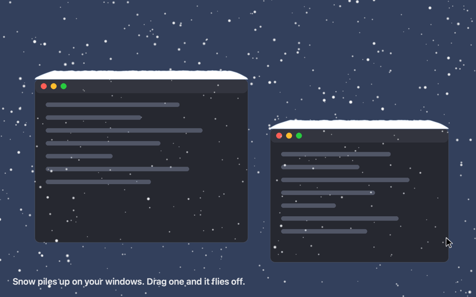

# Snowy Season

Snow and autumn leaves that fall across your Mac desktop and settle on top of your windows. Or a cat that moves in.



- **Snow** builds up into drifts along window tops. Drag a window and the snow flies off.
- **Autumn leaves** tumble down and pile up on windows. Sweep them away with a quick flick of the pointer.
- **Cat** strolls in along the Dock, climbs the sides of your windows, leaps between their tops, grooms and naps on them. It goes to see any window that opens or comes to the front. Drag its window gently and it rides along; shake it and the cat is thrown off. Wiggle the pointer just above its window and it gives chase; rest the pointer on it to pet it; flick the pointer at it and it jumps. It lives on the screen with the menu bar.

It lives in the menu bar. Pick snow, leaves or the cat there, or turn it off. Clicks always pass through to whatever is underneath.

## Run it

```sh
nix run github:dahaoxx/snowyseason
```

Needs macOS 14 or later (Apple silicon or Intel) and [Nix](https://nixos.org/download) with flakes enabled. The first run downloads the Swift toolchain from the Nix binary cache to build the app; after that it starts straight away.

To keep a copy in Applications:

```sh
nix build github:dahaoxx/snowyseason
cp -R result/Applications/SnowySeason.app /Applications/
```

No permissions are needed. Window positions come from the window list, which macOS shares without Screen Recording access.

## Develop

```sh
swift build
swift test
.build/debug/SnowySeason
```

- `Sources/WeatherCore`: pure geometry, pile physics and the cat's leaps and climbing routes, covered by the tests.
- `Sources/SnowySeasonKit`: the app (menu, overlay windows, window tracking, SpriteKit scene); `Sources/SnowySeason` just launches it.
- `nix/package.nix`: builds the `.app` bundle with nixpkgs' Swift toolchain.
- `Sources/DemoRecorder`: renders `docs/demo.gif` offscreen, with scripted stand-in windows instead of a screen recording. Regenerate it with `swift run -c release DemoRecorder`.
